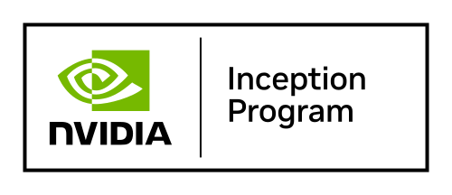

<div align="center">

<a href="https://pygrassreal.ai">
  
</a>

# PyGrassReal 4D Dynamic Splat (`.py4s`) File Format
### The Generational 4D Spatiotemporal Asset Standard for Unreal Engine 5, Unity, and Real-Time Graphics

[](SPECIFICATION.md)
[](LICENSE)
[](https://www.nvidia.com/en-us/startups/)
[](docs/COPYRIGHT_RECORDATION_GUIDE.md)
[](docs/IANA_MIME_REGISTRATION_DRAFT.md)
[](#-binary-layout-overview)
[](#%EF%B8%8F-official-implementations)

**The Official Generational Single-Container Asset Standard Combining 4D Dynamic Gaussian Splatting Visuals with Synchronized Real-Time Deformable Physics Collision.**

[📖 Read Specification](SPECIFICATION.md) • [📋 DIP Copyright Guide](docs/COPYRIGHT_RECORDATION_GUIDE.md) • [🐍 Python SDK](python/) • [⚡ C++ Implementation](cpp/) • [🎯 Unity C#](unity/) • [🌐 TypeScript / Web](typescript/) • [🏛️ Official Platform](https://pygrassreal.ai)

<br/>

<a href="https://www.nvidia.com/en-us/startups/">
  
</a>

<p><strong>PyGrassReal is a member of the NVIDIA Inception program</strong>, nurturing cutting-edge startups revolutionizing spatial computing, neural rendering, and generative 4D technologies.</p>

</div>

---

## 💡 The 4D Spatial Computing Challenge

Traditional 4D Gaussian Splatting and dynamic neural representations generate stunning spatiotemporal radiance fields, but suffer from critical deployment bottlenecks in production game engines:
1. **File Fragmentation:** Storing dynamic splats as separate keyframe PLY files per frame consumes gigabytes of storage (e.g., 90 frames $\times$ 15 MB = **1.35 GB** for a 3-second clip).
2. **Ghost Dynamic Assets:** Traditional 4DGS is purely optical radiance with **zero physical interaction**, causing characters, cameras, and physics actors in Unreal Engine 5 and Unity to pass straight through moving subjects.
3. **Desynchronized Physics:** Manually rigging collision cages to neural Gaussian deformation leads to desynchronized scaling, jitter, and manual alignment overhead.
4. **Bandwidth & Streaming Bloat:** Uncompressed multi-frame point clouds create severe memory bottlenecks on runtime streaming and mobile devices.

---

## 🚀 The PyGrassReal Innovation: Native Single-Container Standard

Developed and standardized by **PyGrassReal AI**, the **`.py4s`** format solves this industry-wide bottleneck by encapsulating high-fidelity 4D Gaussian Splatting, temporal deformation, and synchronized collision geometry into a unified, ultra-lightweight binary container:

1. **Visual Layer (4D Gaussian Splatting):** High-density 4DGS payload compressed with SPZ algorithms, reducing file size by up to **85%** while retaining 100% of Gaussians.
2. **Deformation Layer:** Temporal motion field driving dynamic Gaussian transformations across time.
3. **Physics Layer (Deformable Collider):** Precision collision hitbox that deforms synchronously with the moving character in real-time.
4. **Metadata & Preview:** Embedded spatiotemporal metadata (FPS, duration, looping) and animated preview.

> **1-Click Engine Ready:** Drag a single `.py4s` file into Unreal Engine 5 or Unity — it renders photorealistic dynamic 4DGS splats with synchronized deformable collision physics **instantly with zero manual calibration**.

---

## 📐 Binary Layout Overview

A `.py4s` file consists of a fixed **128-byte Header** followed by 5 contiguous payload sections:

```text
┌────────────────────────────────────────────────────────┐
│             PY4S File Header (128 Bytes)               │  Offset 0x00
├────────────────────────────────────────────────────────┤
│     Section 1: Visual Layer (Compressed 4DGS Payload)  │  Offset = SpzOffset (default 0x80)
├────────────────────────────────────────────────────────┤
│     Section 2: Deformation Layer (Temporal Motion)     │  Offset = DeformationOffset
├────────────────────────────────────────────────────────┤
│     Section 3: Physics Layer (Deformable Collider)     │  Offset = ColliderOffset
├────────────────────────────────────────────────────────┤
│     Section 4: Metadata Layer (Spatiotemporal)         │  Offset = MetadataOffset
├────────────────────────────────────────────────────────┤
│     Section 5: Visual Preview Layer (Optional Preview) │  Offset = ThumbnailOffset
└────────────────────────────────────────────────────────┘
```

### 128-Byte Fixed Header Layout

| Field | Type | Size | Description |
|---|---|---|---|
| `Magic` | `char[4]` | 4 B | Always `"PY4S"` (`0x50 0x59 0x34 0x53`) |
| `VersionMajor` | `uint16` | 2 B | Major version (`1`) |
| `VersionMinor` | `uint16` | 2 B | Minor version (`0`) |
| `SectionCount` | `uint32` | 4 B | Number of active sections (`4` or `5`) |
| `Flags` | `uint32` | 4 B | Payload encoding and compression flags |
| `SpzOffset` | `uint64` | 8 B | Byte offset to Section 1 (Compressed 4DGS Payload) |
| `SpzSize` | `uint64` | 8 B | Visual Layer size in bytes |
| `DeformationOffset`| `uint64`| 8 B | Byte offset to Section 2 (Temporal Motion Layer) |
| `DeformationSize`  | `uint64`| 8 B | Deformation Layer size in bytes |
| `ColliderOffset` | `uint64` | 8 B | Byte offset to Section 3 (Deformable Collider) |
| `ColliderSize` | `uint64` | 8 B | Deformable Collision geometry size in bytes |
| `MetadataOffset` | `uint64` | 8 B | Byte offset to Section 4 (Spatiotemporal Descriptor) |
| `MetadataSize` | `uint64` | 8 B | Metadata size in bytes |
| `ThumbnailOffset`| `uint64` | 8 B | Byte offset to Section 5 (Visual Preview Layer) |
| `ThumbnailSize` | `uint64` | 8 B | Visual Preview size in bytes (0 if none) |
| `Reserved` | `uint8[32]` | 32 B | Zero-padded for future extensions |

For comprehensive technical specifications, read [SPECIFICATION.md](SPECIFICATION.md).

---

## 🛠️ Official Implementations

This repository includes open-source reference implementations across multiple platforms:

### 1. Python SDK (`python/`)
Zero-dependency Python implementation for packing, unpacking, and CLI batch operations:

```bash
# Unpack a .py4s container into component layers
python python/py4s_codec.py unpack model.py4s -o ./output/

# Pack canonical splat, deformation weights, and collider into a single .py4s container
python python/py4s_codec.py pack --spz canonical.spz --deformation deform.bin --collider hitbox.glb --metadata metadata.json -o model.py4s

# Inspect file contents and spatiotemporal metadata
python python/py4s_codec.py info model.py4s
```

### 2. C++ SDK (`cpp/`)
High-performance C++ codec for game engines (Unreal Engine 5, Unity native plugins, custom DirectX/Vulkan engines):
- [Py4sFormat.h](cpp/Py4sFormat.h): Core structure definitions and endianness validation.
- [Py4sReader.h](cpp/Py4sReader.h) / [Py4sReader.cpp](cpp/Py4sReader.cpp): Streamlined container unpacker with Unreal Engine support.
- [Py4sWriter.h](cpp/Py4sWriter.h) / [Py4sWriter.cpp](cpp/Py4sWriter.cpp): High-speed binary container packer.

```cpp
#include "Py4sReader.h"

PyGrassReal::FPy4sContainer Container;
if (PyGrassReal::FPy4sReader::UnpackFromFile(TEXT("D:/Models/character.py4s"), Container))
{
    UE_LOG(LogTemp, Log, TEXT("Loaded 4DGS: %d frames at %f FPS"), 
        Container.Metadata.TotalFrames, Container.Metadata.FPS);
}
```

### 3. Unity C# SDK (`unity/`)
Native C# codec for Unity 2022.3+, Unity 2023, and Unity 6 (URP & HDRP):
- [Py4sReader.cs](unity/Py4sReader.cs): Pure C# container unpacker and metadata parser using `BinaryReader` and `JsonUtility`.

```csharp
using UnityEngine;
using PyGrassReal;

if (Py4sReader.UnpackFromFile("Assets/Models/character.py4s", out Py4sContainer container))
{
    Debug.Log($"Loaded 4DGS: {container.Metadata.temporal.total_frames} frames @ {container.Metadata.temporal.fps} FPS");
}
```

### 4. TypeScript / Web (`typescript/`)
Web / Three.js codec:
- [py4sCodec.ts](typescript/py4sCodec.ts): Pure TypeScript container unpacker and packer using `DataView` for high-speed browser client execution.
- [py4sCodec.test.ts](typescript/py4sCodec.test.ts): Vitest test suite ensuring specification compliance.

```typescript
import { Py4sCodec, isPy4sBuffer, getPy4sBaseVisual } from './py4sCodec';

const response = await fetch('character.py4s');
const arrayBuffer = await response.arrayBuffer();

if (isPy4sBuffer(arrayBuffer)) {
  const container = Py4sCodec.unpack(arrayBuffer);
  console.log(`Loaded 4DGS: ${container.metadata.temporal?.total_frames} frames`);
}
```

---

## 🎮 Unreal Engine 5 & Unity Quickstart

### Unreal Engine 5 Workflow
1. Drag and drop any `.py4s` file directly into your Unreal Engine **Content Browser**.
2. Drag the imported asset directly into the **Level Viewport**.
3. The actor spawns instantly with:
   - Real-time GPU Gaussian Splatting dynamic visual layer.
   - Real-time deformable Chaos collision mesh synchronized with the 4DGS animation.
   - Characters, projectiles, and physics actors interact with the moving character immediately!

### Unity (URP / HDRP) Workflow
1. Copy `unity/Py4sReader.cs` into your Unity project's `Assets/Plugins/PyGrassReal/` folder.
2. Place `.py4s` assets in `Assets/StreamingAssets/` or load them at runtime.
3. Call `Py4sReader.UnpackFromFile(...)` to bind Canonical Gaussians to `ComputeBuffer` and update `MeshCollider` vertices per frame.

---

## 🏛️ Intellectual Property & Standardization Status

The `.py4s` file format specification and software implementation are officially recorded by the Department of Intellectual Property (DIP) and undergoing global standardization:

| Authority / Standard Body | Identifier / Record | Status | Document |
|---|---|---|---|
| **Department of Intellectual Property (DIP)** | **Application Form ลข.01** | **Recorded & Filed** | [📄 View Copyright Guide](docs/COPYRIGHT_RECORDATION_GUIDE.md) |
| **NVIDIA Inception Program** | **Official Program Member** | **Approved & Active Member** | [🟢 Program Details](https://www.nvidia.com/en-us/startups/) |
| **Internet Assigned Numbers Authority (IANA)** | **MIME:** `model/vnd.pygrassreal.py4s` | **Standard Media Type Draft** | [🌐 IANA Draft](docs/IANA_MIME_REGISTRATION_DRAFT.md) |
| **Creator & Rights Holder** | **PyGrassReal AI** | **Exclusive Proprietary & Commercial Rights** | [🌐 pygrassreal.ai](https://pygrassreal.ai) |

---

## 📜 License & Attribution

The `.py4s` format specification, reference codecs, and tools are licensed under the **[MIT License](LICENSE)**.

Developed with ❤️ by **[PyGrassReal AI Team](https://pygrassreal.ai)**.  
*Copyright (c) 2026 PyGrassReal AI. All Rights Reserved.*
